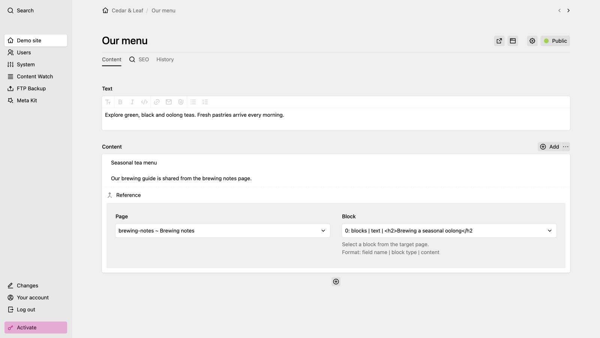

# Reference Block Plugin for Kirby

This plugin allows you to reference other blocks.
Thus, you can easily repeat a block in multiple places on your
page while being able to update it in one central place.




## Getting started

Use one of the following methods to install & use `tearoom1/kirby-block-reference`:


### Git submodule

If you know your way around Git, you can download this plugin as a [submodule](https://github.com/blog/2104-working-with-submodules):

```text
git submodule add https://github.com/tearoom1/kirby-block-reference.git site/plugins/kirby-block-reference
```


### Composer

```text
composer require tearoom1/kirby-block-reference
```


### Clone or download

1. Clone or download this repository from github: https://github.com/tearoom1/kirby-block-reference.git
2. Unzip / Move the folder to `site/plugins`.

## Usage

Use the block by adding it to you blueprints fieldsets if they are defined:

```yaml
fieldsets:
  - reference
```

## Drafts

Blocks of draft pages are only rendered for logged-in users, so a reference to a block on an unpublished page does not show it to visitors. Versions before 1.1 rendered them for everyone; to keep that behaviour:

```php
// site/config/config.php
'tearoom1.kirby-block-reference.renderDrafts' => true,
```

## Access Control

The plugin exposes two API routes that the panel block UI uses to look up reference targets: `block-reference/pages` (list page IDs) and `block-reference/blocks` (return the blocks of a given page, including drafts). Both routes require a logged-in panel user; they return `401 Unauthorized` for anonymous callers. The route names of earlier versions, `getAllPages` and `blocks`, still work and will be removed in the next major version.

By default, only admins can use the reference picker. Non-admin roles can be allowed explicitly:

```php
// site/config/config.php
'tearoom1.kirby-block-reference.allowedRoles' => [
    'editor',
],
```

The page picker and API routes also check Kirby's page `read` permission for every target page. Users only see pages they are allowed to read.

## Developers

The plugin's functions live in `TearoomOne\BlockReference\BlockReference` (`blocksFromPage()`, `canAccess()`, `canReadPage()`, `render()`). The global helpers of earlier versions (`getBlocksFromPage()`, `blockReferenceCanAccess()`, `blockReferenceCanReadPage()`) still exist as deprecated wrappers.

Tests: `composer install && composer test`

## Support

Block Reference is free and MIT licensed, and it stays that way. If it saves you time, you can help keep it maintained. Paying is voluntary and any amount is welcome.

Agencies and companies that need an invoice can get a Supporter License. You choose the price and whether it covers one project or your whole company. Lemon Squeezy handles the sale as merchant of record, so you get a proper invoice with VAT. The license adds no features and no priority support.

[Support this plugin](https://www.tearoom.one/en/kirby-plugins/support)

## License

This plugin is licensed under the [MIT License](LICENSE)

## Credits

- Developed by Mathis Koblin

## Screenshots

Screenshots use sample content at 1408 × 902 pixels. Panel views are cropped to the content area. The main image uses the light theme.

| View | Light | Dark |
| --- | --- | --- |
| Overview | [Light](screenshot.jpg) | [Dark](screenshot-dark.jpg) |
